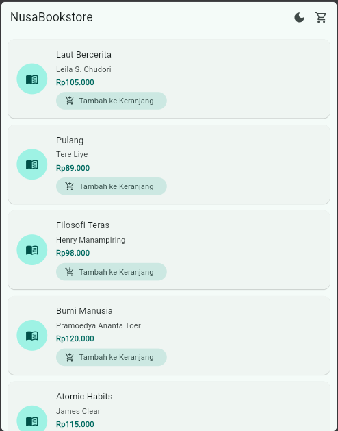
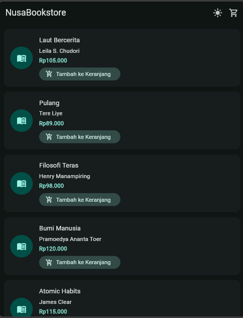
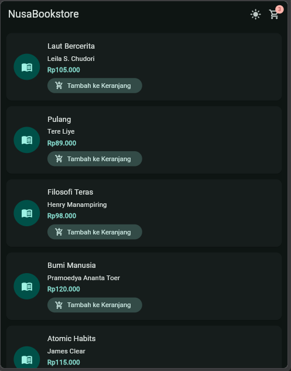
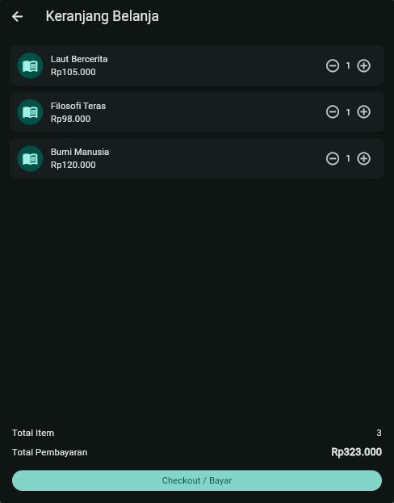
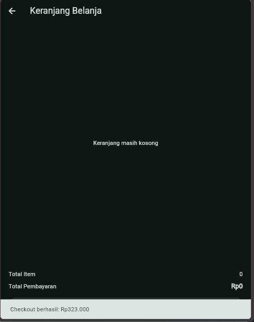

# ppm_sesi_3

A new Flutter project.

## Tampilan Aplikasi

Berikut adalah dokumentasi tangkapan layar (screenshot) hasil implementasi fitur pada aplikasi **NusaBookstore**:

### 1. Halaman Katalog (Light Mode & Dark Mode)
Menampilkan daftar buku yang tersedia lengkap dengan harga serta opsi pengubah tema (Light/Dark Mode).

| Light Mode | Dark Mode |
| :---: | :---: |
|  |  |

---

### 2. Badge Jumlah Keranjang
Indikator angka (badge) pada ikon keranjang di bagian kanan atas *AppBar* yang menunjukkan jumlah produk yang telah ditambahkan.

  

---

### 3. Halaman Keranjang Belanja & Total Harga
Menampilkan rincian daftar barang di dalam keranjang beserta rincian jumlah item dan kalkulasi total pembayaran.

  

---

### 4. SnackBar Setelah Checkout
Pesan notifikasi (*SnackBar*) yang muncul di bagian bawah layar setelah menekan tombol checkout untuk menyelesaikannya.

  

---

## Getting Started

This project is a starting point for a Flutter application.

A few resources to get you started if this is your first Flutter project:

- [Learn Flutter](https://docs.flutter.dev/get-started/learn-flutter)
- [Write your first Flutter app](https://docs.flutter.dev/get-started/codelab)
- [Flutter learning resources](https://docs.flutter.dev/reference/learning-resources)

For help getting started with Flutter development, view the
[online documentation](https://docs.flutter.dev/), which offers tutorials,
samples, guidance on mobile development, and a full API reference.